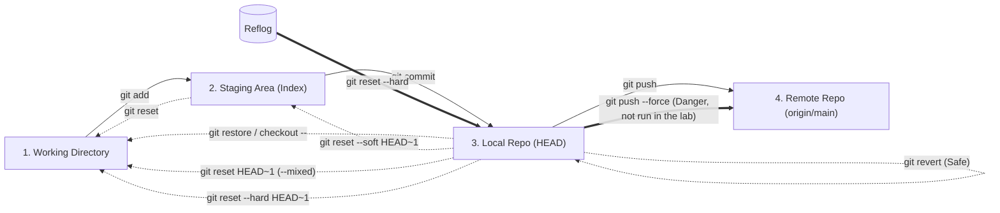

# DEVOP2 — Unit 05: Git Rollbacks & Recovery Lab

Automated lab script and visual guide covering Git undo, reset, revert, reflog recovery, release tag rollbacks, and hotfix workflows.

## Prerequisites

Only Docker. Git and the GitHub CLI (`gh`) are in the `tools` container (`../docker/Dockerfile`).

1. On the machine: `git config --global user.name` / `user.email` set, and `gh auth login` done. The script deletes its test repository at the end, so the token needs the `delete_repo` scope: `gh auth refresh -h github.com -s delete_repo`.
2. `./start.sh` copies these three values into `.env` (git-ignored), builds and starts the container, waits until it is healthy, and prints the next commands.

## Running the Lab

```bash
docker exec -it unit05-tools-1 bash
./TestUnit5.sh                                   # or, to keep the trace:
./TestUnit5.sh 2>&1 | tee TestUnit5_output.txt
```

The script detects your GitHub username via `gh api user --jq '.login'`, creates a throw-away `TestProj` directory and a public `TestProj` repository on your GitHub account, executes Parts 2 through 10 step by step, then deletes both. What matters is the path shown in the output, saved in `TestUnit5_output.txt`.

## Reading the `git_info` Output

After each Git milestone, `git_info` prints prefixed lines showing the exact state of every `.txt` file across all four Git zones:

* `0 ...` — Overall repository `git status` and recent `git log`.
* `1 ...` — **Working Directory** file content.
* `2 ...` — **Staging Area (Index)** content (`git show :file`) and diff against Working Directory.
* `3 ...` — **Local Repository (`HEAD`)** content (`git show HEAD:file`) and diff against Staging Area.
* `4 ...` — **Remote Repository (`origin/main`)** content (`git show origin/main:file`) and diff against `HEAD`.

## Git State Transitions & Rollback Map



## Lab Exercises Covered

| Part | Topic | Key Commands Demonstrated | Safety on Shared Branches |
| :--- | :--- | :--- | :--- |
| **2** | Setup | `git init -b main`, `git add`, `git commit`, `gh repo create` | Safe |
| **3** | Undo Working Dir Edits | `git checkout -- app.txt`, `git restore app.txt` | Destroys uncommitted local edits |
| **4** | Undo Staged Changes | `git reset app.txt` | Safe (keeps local file modifications) |
| **5** | Revert Commits | `git revert --no-edit <hash>` | **Safe** (creates a new commit) |
| **6** | Reset Commits | `git reset --soft`, `--mixed`, `--hard HEAD~1` | **Dangerous** (rewrites commit history) |
| **7** | Recover Lost Commits | `git reflog`, `git reset --hard <hash>` | Local recovery tool |
| **8** | Restore Deleted Files | `rm app.txt` followed by `git restore` / `git checkout HEAD --` | Safe for tracked files |
| **9** | Rollback Releases (Tags) | `git tag v1.0.0`, `git revert HEAD` vs local `git reset --hard v1.0.0` (the `push --force` is explained, **not executed**) | `revert` = Safe; `reset + push --force` = Dangerous |
| **10** | Hotfix Branch Strategy | `git checkout -b hotfix`, `commit`, `checkout main`, `git merge hotfix` | **Best Practice** for production |

## Final Quiz — Reference Answers

1. **What is the difference between `revert` and `reset`?**
   `git revert` creates a brand-new commit that inverses the changes of an earlier commit, preserving existing branch history (safe for shared branches). `git reset` moves the branch pointer backward, rewriting commit history.
2. **Why is `git reset --hard` dangerous?**
   It permanently discards uncommitted changes in both the Staging Area and Working Directory, and if force-pushed to a shared branch, overwrites teammates' commit history.
3. **How can you recover a commit after a hard reset?**
   Run `git reflog` to locate the hash of `HEAD` prior to the reset, then run `git reset --hard <commit-hash>`.
4. **How do you restore a deleted tracked file?**
   Run `git restore <file>` (or `git checkout HEAD -- <file>`). Note that untracked files deleted before ever being staged/committed cannot be restored by Git.
5. **When should you use a hotfix branch instead of `reset`?**
   Whenever fixing bugs on production or shared branches (`main`) where commits have already been pushed and pulled by collaborators or CI/CD pipelines.
